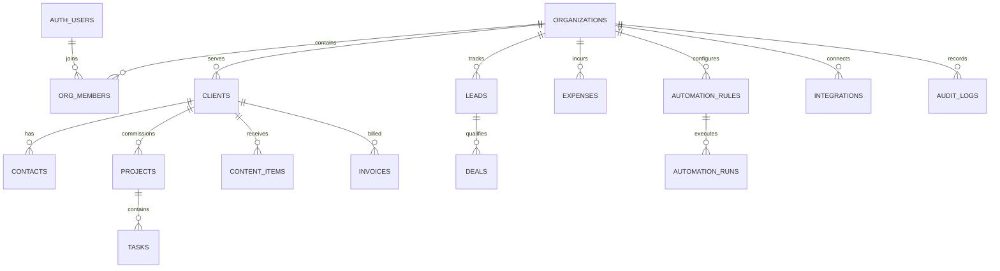

# Let’s Go Central MVP architecture

## Product boundaries

Let’s Go Central is an agency operating system. Let’s Go Digitals is the first customer workspace, represented by an ordinary organization record. There are no customer-specific tables or branches. Domain modules share an organization boundary and link through stable IDs.

## Decisions

| Area | MVP decision | Why |
|---|---|---|
| Web | Next.js 16 App Router + TypeScript | Server-rendered app shell with typed domain boundaries and room for interactive client components |
| Identity | Supabase Auth | Email/password and invitation flows fit the first team; identity is separate from organization membership |
| Data | Supabase-managed PostgreSQL | Relational links, constraints, reporting queries, and JSON for flexible provider payloads |
| Tenant isolation | Shared database, `organization_id` on every tenant-owned row, PostgreSQL RLS | Low operational overhead for the first tenant while enforcing tenant boundaries in the database |
| Authorization | Organization membership roles plus permission keys; RLS-backed helpers | Simple defaults for owner/admin/manager/member/client, with per-organization custom roles |
| Files | Supabase Storage, private buckets, tenant-prefixed paths | Keep client assets private; signed URLs are issued after membership checks |
| Async work | Database-backed run records with a secret-protected worker endpoint and due-rule claim RPC | Keeps scheduled runs auditable, idempotent, and tenant-scoped; the hosting scheduler only needs to call one endpoint |
| AI | Server-only provider adapter, organization-scoped context retrieval, usage logging | Provider can change; tenant data and secrets stay behind server authorization |
| Integrations | Provider adapters; encrypted OAuth credentials referenced by secret manager | Tokens never belong in browser-readable tables or logs |
| Audit | Database triggers capture mutations to business-critical records | Central history independent of UI code paths |

## Data model

Every tenant-owned foreign key is paired with `organization_id` where the referenced data is also tenant-owned. This prevents a row in one tenant from linking to another tenant's client, project, or rule. Money uses fixed precision decimal amounts and the organization defaults to INR; invoices snapshot currency.

## Request and security flow

1. A user authenticates with Supabase Auth; `profiles` stores display fields only.
2. `org_members` links that identity to one or more organizations and a base role.
3. The app resolves the active organization from the user's memberships. Every domain query includes that organization ID for clarity and index use.
4. PostgreSQL RLS independently checks active membership for reads and permission helper checks for writes. A forged organization ID therefore cannot cross tenants.
5. Organization creation runs through the `create_organization` database function, which atomically creates the tenant, owner membership, and administrator role.
6. Invitations are created by an authorized server action and accepted only when the authenticated user's email matches the invitation. The service-role key is server-only; callbacks never trust a caller-supplied identity.
7. Audited mutations emit an audit row. Audit data is read-only to authenticated client roles.

`owner` and `admin` can manage all tenant data. `manager` can do normal workspace writes but cannot administer organization settings, finance, or membership. Internal `member` is read-only in this initial permission set. A `client` identity is deliberately excluded from internal organization data until a separately scoped client portal policy exists. Custom role assignments can grant `workspace.write`; expand permissions by domain before exposing finance or client portal writes.

## Domain modules

- **Sales:** leads, deals, pipeline stage/value/owner/next action; lead search, creation, stage changes, and organization-checked aggregates are in place. A won lead converts atomically to one client, an optional primary contact, and a won deal.
- **Clients:** tenant-scoped directory, client creation with an optional primary contact, contact records, monthly service value, health, and a first client 360 page for linked projects and receivables.
- **Delivery:** projects, tasks, status, priority, owner, due dates, blockers. Task assignees must be active internal members of the same organization; a database trigger enforces this invariant in addition to RLS.
- **Content:** calendar entries with channel, format, review state, and publish schedule.
- **Finance:** invoices, receivables, expenses; no payment card data. Add payment provider webhooks and reconciliation as a later phase.
- **Team:** auth identities, profiles, memberships, custom roles, workload derived from assigned open tasks. New-user invites use Supabase Auth email delivery and a server-only service key; the callback activates membership only when the authenticated identity matches the invitation email. Membership role/status edits and invitation revocations are audited; owner transfer remains separate.

Custom roles can currently grant only `workspace.write` and `finance.manage`. Organization settings, member invitations, role editing, and access administration require an owner or admin base role. This prevents a custom role from granting itself membership-administration capability.
- **Founder dashboard:** aggregate revenue, receivables, pipeline, profit, risks, recent activity. Production values must come from organization-scoped queries; current UI values are clearly illustrative preview values.
- **AI:** server-only Responses API adapter, organization-scoped workspace snapshots, private member-owned conversations and drafts, token usage logging, and a per-member 10 requests/minute limit. Provider requests disable response storage. AI can prepare a structured task draft; an authenticated user edits and explicitly confirms it before a security-definer transaction revalidates organization permission, project, assignee, draft ownership, and expiry, creates the task, and writes audit events. Optional per-request cost estimates use operator-configured token prices; organization spend caps and automatic price catalog updates remain future work.
- **Automation:** task rules can run manually, hourly/daily/weekly, or when a lead is created. A database trigger enqueues tenant-scoped lead events; a shared external scheduler calls a bearer-secret-protected endpoint; a Postgres worker claims due schedules and event runs with `SKIP LOCKED`, advances next-run times, and records idempotent run/attempt/task results in one transaction. Other event/webhook triggers remain future work.
- **Integrations:** tenant-scoped provider registry in the DB; connected states are not client-writable. Slack OAuth uses signed, short-lived state and an AES-256-GCM encrypted credential vault. Tokens are decrypted only on the server, refreshed when Slack token rotation is enabled, and never returned to a browser. The current Slack action sends a message to a channel where the bot is already a member. Other providers remain registry-only.
- **Automation scope:** the first supported action is atomic task creation. External event/webhook triggers and general-purpose job execution remain future work.

## Important safeguards

- Never ship a service-role key, OAuth refresh token, or AI provider key to the browser. Keep `OPENAI_API_KEY` and `OPENAI_MODEL` on the server.
- Keep `SLACK_CLIENT_SECRET`, `OAUTH_STATE_SECRET`, and `INTEGRATION_ENCRYPTION_KEY_BASE64` server-only. Back up the encryption key securely; losing it makes stored provider credentials unreadable.
- Do not rely on hidden navigation or client-side role checks for authorization.
- Enable RLS and grants for every new API-exposed table. Review views/functions for RLS bypass behavior.
- Validate imported/webhook input at the server boundary and make event handlers idempotent.
- Keep `AUTOMATION_WORKER_SECRET` server-only and rotate it if a scheduler credential is exposed.
- Keep audit rows append-only and avoid storing secrets or unnecessarily sensitive personal information in change payloads.
- Use organization ID in cache keys, background-job payloads, storage paths, and AI retrieval filters.
- Back up the database and define retention/export/delete workflows before onboarding external tenants.

## Finance ledger behavior

Invoice payments are append-only ledger entries. A database trigger locks the invoice while checking the remaining amount, rejects overpayments and currency mismatches, and recalculates the invoice's paid amount and status. Direct clients cannot edit those calculated fields or delete issued invoices. Finance summaries group by currency and use the organization's timezone for month and due-date boundaries. Reports show cash received, expenses, net cash by month, and receivables aging without combining currencies. Refunds, credit notes, tax-region rules, and payment-provider reconciliation are not part of this first finance slice.

## References

- [Next.js App Router](https://nextjs.org/docs/app)
- [Supabase SSR authentication](https://supabase.com/docs/guides/auth/server-side)
- [Supabase Row Level Security](https://supabase.com/docs/guides/database/postgres/row-level-security)
- [Supabase Next.js quickstart](https://supabase.com/docs/guides/getting-started/quickstarts/nextjs)
- [OpenAI Responses API reference](https://developers.openai.com/api/reference/cli/resources/responses/methods/create)
